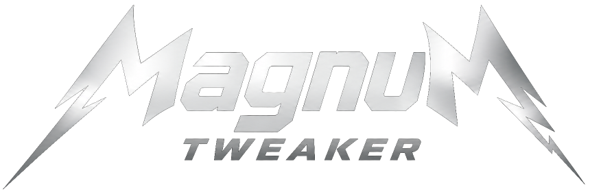

<p align="center">
  
</p>

# Magnum Tweaker

**Portable Windows 10/11 x64 performance and gaming settings manager**

[Русский](#русский) · [English](#english) · [Releases](../../releases) · [Telegram @bigmagnum1337](https://t.me/bigmagnum1337) · [Contributor guide](AGENTS.md)

## Русский

Magnum Tweaker проверяет настройки производительности Windows и позволяет применять и откатывать поддерживаемые изменения. Приложение написано на C#, .NET 8 и WPF.

- **Каталог.** 86 базовых карточек для каждого профиля Windows. Сетевые карты могут добавлять настройки в зависимости от драйвера. Есть поиск, фильтры по состоянию и риску, сортировка и раскрываемые описания.
- **Magnum pack.** Применяет оставшиеся доступные настройки набора за одно действие. В набор входят игровые и сетевые параметры, настройки отзывчивости и 14 параметров питания от сети. Профиль батареи сохраняется. Повышенное энергопотребление может увеличить нагрев и шум.
- **GTA V.** В базовый каталог входят четыре проверки служб Windows, отмеченных в памятке Majestic / GTA5RP. Эти карточки работают в режиме чтения.
- **Справочник.** 236 записей. Некоторые открывают соответствующую карточку или страницу параметров Windows. Большая часть исходного материала на русском.
- **Интерфейс.** Русский и английский языки, профили Windows 10/11, сворачиваемая панель категорий и общая регулировка громкости.

### Как пользоваться

1. Откройте раздел **Assets** на странице релиза, скачайте `Windows.x64.Portable.zip` и распакуйте архив. Запустите `Magnum Tweaker.exe`. [Скачать релиз](../../releases/latest)
2. Выберите язык и свою версию Windows, примите условия использования и дождитесь проверки. Она покажет состояние настроек.
3. Найдите нужный твик и нажмите **Применить**. Набор твиков доступен в категории **Готовые настройки**. Если приложение предложит создать точку восстановления, её можно создать прямо в этом окне. Для некоторых изменений Windows запросит права администратора.
4. Чтобы вернуть исходное значение, нажмите **Откат** на карточке, если кнопка доступна. Чтобы обновить статусы, нажмите **Проверить всё**.

Настройки интерфейса и данные для отката хранятся в `%LOCALAPPDATA%\MagnumTweaker`. [VirusTotal для EXE из опубликованного релиза 1.1](https://www.virustotal.com/gui/file/56d4549d1cf071d777a911273608143ee52203826f3ac60c9388f806ec82d97e)

Один автономный EXE предназначен для Windows 10 и 11 на x64. Доступность отдельных твиков зависит от версии и редакции Windows, драйверов и оборудования. Статус подтверждает значение настройки. FPS, задержка ввода и пинг оцениваются отдельными замерами в игре. [Поддерживаемые версии Windows для .NET](https://learn.microsoft.com/dotnet/core/install/windows#supported-versions)

### Сборка и тесты

Откройте [Magnum-Tweaker.sln](Magnum-Tweaker.sln) в Visual Studio или VS Code с C# Dev Kit. Команды ниже запускаются из корня репозитория в Windows с .NET 8 SDK.

```powershell
.\pipelines\Build.ps1
.\pipelines\Run-Test.ps1
```

Готовый EXE находится в `dist\Magnum Tweaker.exe`, отчёт тестов — в `artifacts\test-results\MagnumTweaker.trx`. Для запуска готового EXE отдельный .NET Runtime не требуется. GitHub Actions запускает **Build** и **Run Test** на push, pull request и вручную.

## English

Magnum Tweaker is a C#, .NET 8, and WPF desktop app for checking, applying, and restoring supported Windows performance settings.

- **Catalog.** 86 base cards per Windows profile. Network adapters may expose additional settings depending on the driver. Search, status and risk filters, sorting, and expandable descriptions help you find each setting.
- **Magnum pack.** Applies the remaining available preset changes in one action. It groups gaming, networking, responsiveness, and 14 AC power settings. Battery settings stay as configured. Higher power draw may increase heat and fan noise.
- **GTA V.** The base catalog includes four read-only checks for Windows services flagged in the Majestic / GTA5RP reference material.
- **Reference guide.** 236 entries. Some open the corresponding catalog card or Windows settings page. Most source material is in Russian.
- **Interface.** Russian and English, Windows 10/11 profiles, a collapsible sidebar, and one volume control for interface sounds.

### Getting started

1. Under **Assets** on the release page, download and extract `Windows.x64.Portable.zip`, then run `Magnum Tweaker.exe`. [Download the release](../../releases/latest)
2. Choose your language and Windows version, accept the terms, and wait for the scan to show the current status of your settings.
3. Find a tweak and click **Apply**. The preset is available under **Presets**. If prompted to create a restore point, you can make one in the app. Windows may request administrator permission for some changes.
4. To bring back the original setting, click **Restore** on its card when available. Click **Check all** to refresh the status of the tweaks.

Preferences and rollback data are stored in `%LOCALAPPDATA%\MagnumTweaker`. [VirusTotal for the published 1.1 executable](https://www.virustotal.com/gui/file/56d4549d1cf071d777a911273608143ee52203826f3ac60c9388f806ec82d97e)

One self-contained x64 EXE targets Windows 10 and 11. Individual tweaks depend on the Windows release and edition, drivers, and hardware. The status verifies the setting value. FPS, input latency, and ping require separate in-game measurements. [Windows versions supported by .NET](https://learn.microsoft.com/dotnet/core/install/windows#supported-versions)

### Build and test

Open [Magnum-Tweaker.sln](Magnum-Tweaker.sln) in Visual Studio or VS Code with C# Dev Kit. Run these commands from the repository root on Windows with the .NET 8 SDK.

```powershell
.\pipelines\Build.ps1
.\pipelines\Run-Test.ps1
```

The portable EXE is written to `dist\Magnum Tweaker.exe` and the test report to `artifacts\test-results\MagnumTweaker.trx`. The published EXE includes the .NET Runtime. GitHub Actions runs **Build** and **Run Test** on pushes, pull requests, and manual dispatch.

## Структура репозитория / Repository layout

| Path | Назначение / Purpose |
| --- | --- |
| [src/MagnumTweaker](src/MagnumTweaker) | Приложение, манифест и общие стили / WPF app, manifest, and shared styles |
| [UI](src/MagnumTweaker/UI) | Окна, элементы управления и локализация / Windows, controls, and localization |
| [Models](src/MagnumTweaker/Models), [Services](src/MagnumTweaker/Services) | Каталог, наборы, настройки Windows и откат / Catalog, presets, Windows operations, and rollback |
| [Assets](src/MagnumTweaker/Assets) | Логотип, иконка, шрифты и справочник / Logo, icon, fonts, and reference data |
| [tests](tests) | Тесты xUnit / xUnit tests |
| [pipelines](pipelines), [.github/workflows](.github/workflows) | Сборка и проверки / Build and test automation |

Правила работы с репозиторием / Contribution rules in [AGENTS.md](AGENTS.md).

Шрифты / Fonts: [Inter](src/MagnumTweaker/Assets/Fonts/Inter-OFL.txt) · [Manrope](src/MagnumTweaker/Assets/Fonts/Manrope-OFL.txt).
